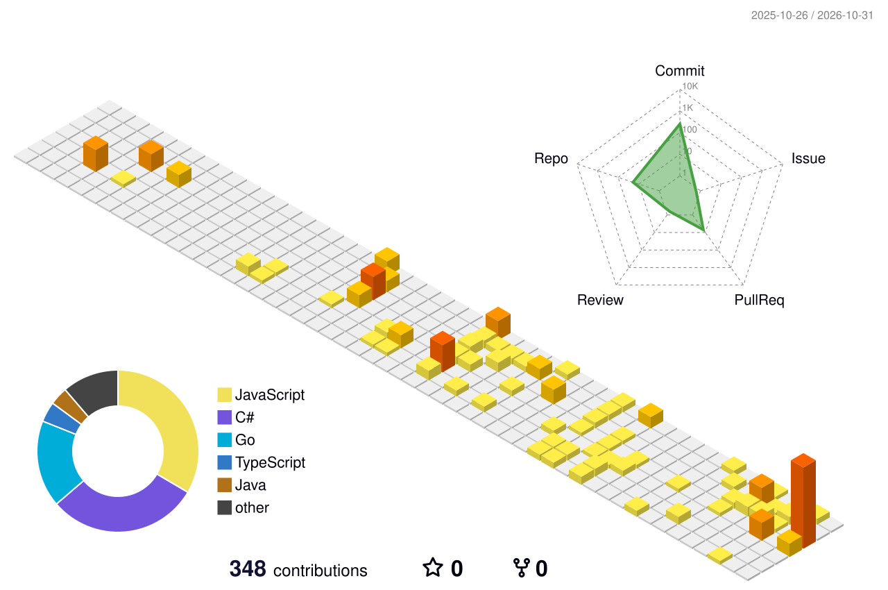

<div align="center">


<a href="https://git.io/typing-svg">
  
</a>

<p>
  <a href="https://www.linkedin.com/in/dimas-setiaji-596b33335/"></a>
  <a href="mailto:setiajidimas25@gmail.com"></a>
  
</p>

</div>

---

### 🙋 About me

```ts
const dimas = {
  studying: "Informatics @ Institut Teknologi Sepuluh Nopember",
  building: ["web apps", "games", "small tools"],
  currentlyLearning: ["system design", "Go backend patterns"],
  funFact: "I unwind by grinding CP problems",
};
```

### 🛠️ Tech stack

<p align="center">
  <b>Web</b><br/>
  
</p>
<p align="center">
  <b>Game dev</b><br/>
  
</p>
<p align="center">
  <b>CP & tools</b><br/>
  
</p>

### 📌 Things I've built

<table>
  <tr>
    <td width="50%" valign="top">
      <h4>🏠 <a href="https://github.com/setiAjiid/real-estate-ecommerce">RumahKu</a></h4>
      <p>Property marketplace with role-based auth, listings, reviews, and an AI chatbot.</p>
      
      
      
      <br/><br/>
      <a href="https://real-estate-ecommerce-alpro.vercel.app">🔗 Live demo</a>
    </td>
    <td width="50%" valign="top">
      <h4>🎓 <a href="https://github.com/setiAjiid/SIPMABA-v2.0">SIPMABA v2.0</a></h4>
      <p>Student admission system with encrypted API traffic and AES/DES/RC4 file encryption.</p>
      
      
      
    </td>
  </tr>
  <tr>
    <td width="50%" valign="top">
      <h4>🎭 <a href="https://github.com/setiAjiid/Pasuryan_Gemastik2026">Pasuryan</a></h4>
      <p>A 2D narrative game about the social masks we wear every day.</p>
      
      
      
    </td>
    <td width="50%" valign="top">
      <h4>🧩 <a href="https://github.com/setiAjiid/ICPC-Dream">ICPC-Dream</a></h4>
      <p>My daily competitive programming log: AtCoder, Codeforces, and CSES.</p>
      
    </td>
  </tr>
</table>

### 📊 GitHub activity

<div align="center">
  
  
  <br/><br/>
  <picture>
    <source media="(prefers-color-scheme: dark)" srcset="profile-3d-contrib/profile-night-green.svg" />
    <source media="(prefers-color-scheme: light)" srcset="profile-3d-contrib/profile-green-animate.svg" />
    
  </picture>
</div>


